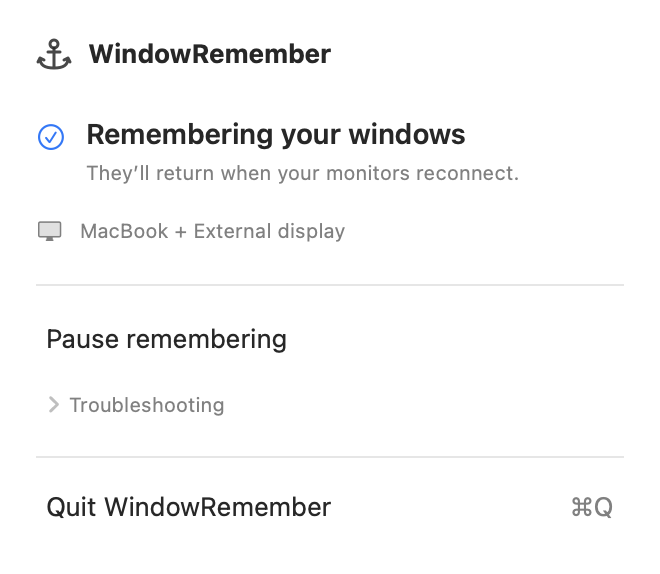
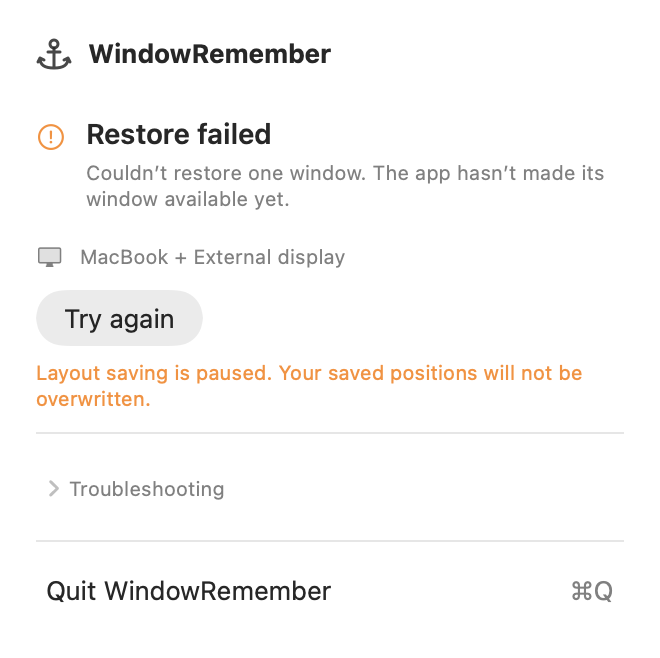
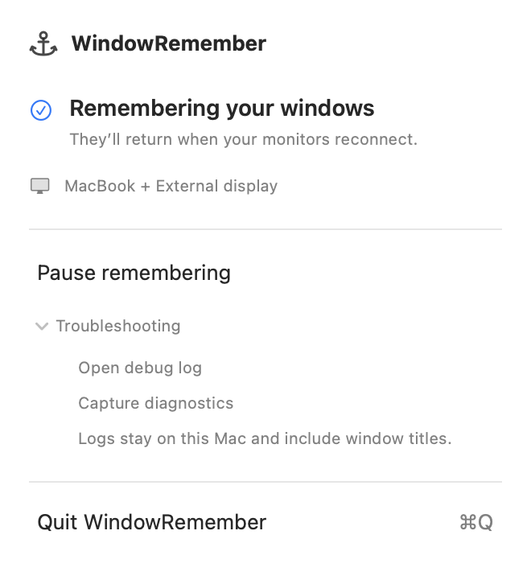
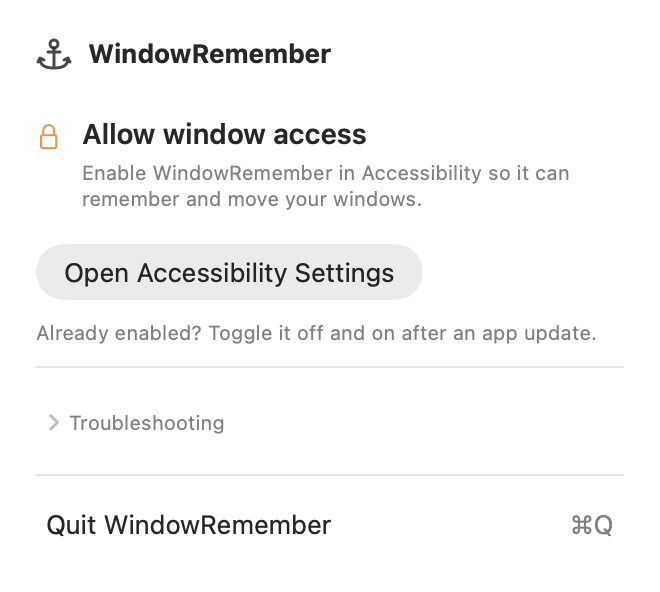

# WindowRemember

A small macOS menu bar app that remembers where your windows belong when you connect or disconnect monitors.

Arrange your windows and keep working. WindowRemember learns their positions and sizes in the background, keeps a separate memory for each combination of monitors, and restores the matching arrangement when that setup returns or your Mac wakes.

No scenes, presets, accounts, subscriptions, dashboard, or separate main window.

## Screenshots

The app’s actual interface, rendered with sample monitor data. No desktop contents or private window titles are included.

<p>
  
  
  
</p>

<details>
<summary>Accessibility setup</summary>



</details>

## Download and install

**[Download the latest release](https://github.com/aduggleby/WindowRemember/releases/latest)**

Requires **macOS 14 Sonoma or later**. The release ZIP contains a universal app for **Apple silicon and Intel**. **Version 1.1.9 is Developer ID signed but not Apple-notarized.** macOS may block its first launch. Only if you trust the download, approve it yourself in **System Settings → Privacy & Security → Open Anyway**. No security settings need to be disabled. See the release notes for build details.

1. Download and unzip `WindowRemember-1.1.9-universal.zip`.
2. Move **WindowRemember.app** to **Applications** before opening it.
3. Open it and click the **anchor icon** in the menu bar.
4. Click **Open Accessibility Settings**, then enable WindowRemember under **Privacy & Security → Accessibility**. This is the macOS permission needed to read and move other apps’ windows.
5. Put your windows where you want them and allow a few seconds for learning.

WindowRemember requests start-at-login registration on its first launch from Applications. If macOS asks, approve it in **General → Login Items & Extensions**. You can disable startup there later; the app respects that choice.

## Everyday use

Leave the app running. Positions are sampled about every three seconds. When your display setup changes, learning pauses while displays settle, then the matching saved arrangement is restored automatically. A previously unseen setup starts learning its own arrangement.

The popover normally shows only its status, connected monitors, **Pause remembering**, collapsed **Troubleshooting**, and **Quit**. There is no save button and no layout selection.

Wake and reconnect captures are retried with fresh Accessibility references when the system exposes invalid or incomplete window data. Saved layouts remain protected during retries and across restarts. If a restore fails, the popover opens automatically with **Restore failed** and **Layout saving is paused**. **Try again** retries the saved arrangement. Saving stays paused across restarts until a retry succeeds or you explicitly accept the current positions. The saved arrangement is protected from being overwritten by misplaced windows. To deliberately replace it, expand Troubleshooting and choose **Use current window positions instead**.

## Troubleshooting

- **Menu bar icon disappears:** the app now retains its native status item independently of the popover and checks it on wake, display changes, and once a minute. Reopening the app from Applications opens the popover. macOS can still hide menu items when the menu bar is full; close another app’s menu items or use a larger display. Diagnostics include status-item visibility, frame, process ID, heartbeat, and clean termination events to distinguish a hidden item from an app exit.

- **Access needed:** enable Accessibility for the copy in Applications. After replacing a development build, macOS may require toggling access off and on. Quit older copies so only one instance is running.
- **A window did not return:** open its app, reconnect the expected monitor, and click **Try again**. Closed apps are not launched automatically.
- **Windows App / remote desktop:** full-screen sessions exposed through Accessibility are captured through both the window list and focused/main-window attributes. Moving a full-screen session to another monitor temporarily exits full-screen, moves it, and enters full-screen again. macOS may change Spaces during this operation, and the remote client may reject a transition.
- **Collect evidence:** expand Troubleshooting and use **Capture diagnostics** or **Open debug log**. Review and redact logs before sharing them in a public issue.

Window matching uses app identifiers, window titles, and window order. Windows App requires an exact title match so the connection browser cannot be mistaken for a remote session. Minimized windows, closed apps, some nonstandard windows, and windows that apps do not expose through Accessibility may be unavailable. The app does not implement complete multi-Space restoration or use private Spaces APIs. Physical dock, monitor, and full-screen behavior varies by app and needs validation on your own setup.

## Privacy

There is **no telemetry, account, server, or in-app upload**. Layouts and diagnostics remain on your Mac:

```text
~/Library/Application Support/WindowRemember/layouts.json
~/Library/Application Support/WindowRemember/Diagnostics/debug.jsonl
~/Library/Application Support/WindowRemember/Diagnostics/debug.previous.jsonl
```

Layouts contain app identifiers, window titles, monitor identities, and frames. Diagnostic logs record changed layouts, matching decisions, macOS Accessibility errors, full-screen transitions, status-item health, and restore outcomes. Full per-window capture details are collected on manual diagnostic snapshots and restores. Normal polling does not emit full dumps, and unchanged layouts are not rewritten. Log records are batched for up to five seconds to reduce disk writes; manual snapshots and orderly shutdown flush immediately. Logs rotate at approximately 5 MB, keeping one previous file (about 10 MB total). They can contain private document titles and remote host names.

Quit the app before deleting its local data to reset it. Local data, diagnostics, signing credentials, and release build products are excluded from Git.

## Build from source

Requires Xcode or a compatible Swift toolchain and the macOS SDK. No external package dependencies.

```sh
git clone https://github.com/aduggleby/WindowRemember.git
cd WindowRemember
./scripts/build-app.sh
open dist/WindowRemember.app
```

The default build targets your Mac’s architecture and is ad-hoc signed for local use. For a universal build:

```sh
WR_UNIVERSAL=1 ./scripts/build-app.sh
```

To sign a distribution build, set `WR_SIGN_IDENTITY` to your own **Developer ID Application** identity. The build enables the hardened runtime and a secure timestamp when that variable is supplied. Signing credentials are never stored in the repository. Apple notarization is a separate release step; follow Apple’s [notarization workflow](https://developer.apple.com/documentation/security/customizing-the-notarization-workflow).

Run the regression tests:

```sh
swift test --disable-sandbox
```

Tests cover window eligibility, remote-session matching, and migration from earlier local data formats. They do not simulate a physical monitor reconnect.

## License

[MIT](LICENSE). Independently implemented using SwiftUI, AppKit, and the public Accessibility APIs. Inspired by the window-memory workflow of [Putback](https://putback.app/); not affiliated with it.

### Refresh documentation screenshots

The app can render its real menu interface with synthetic data, without capturing the desktop or reading saved layouts:

```sh
swift build -c release
.build/release/WindowRemember --render-screenshots "$PWD/docs/screenshots"
```

Diagnostic logs rotate into uniquely named files in `Diagnostics/Archive` and are never automatically deleted. Updates preserve the entire diagnostics directory, including legacy logs. To install a locally built app with a separate diagnostic backup, run `./scripts/install-app.sh`. Archives contain private window titles and remain on your Mac.
